# Snowflake results: the pipeline run for real, with EDA

First live run of this project on Snowflake (trial account, Enterprise, AWS
US East 2), 15 Oct 2026. Everything below was executed against the account;
the screenshots are from Snowsight and the charts are drawn from live queries
(`analysis/eda_charts.py`). **Total cost of the run: 0.49 credits (about
$1.50)**, under an account-wide resource monitor capped at 110 credits.

---

## 1. What was built, in order

| Step | What ran | Result |
|---|---|---|
| 0. Safety | `TRIAL_SPEND_CAP` resource monitor (110 credits, notify 50/80%, hard stop 100%); 60 s auto-suspend | Active |
| 1. Bronze | `sql/02_bronze` | Failed first (bug 1), fixed, then 5/5 statements OK |
| 2. Silver | `sql/03_silver`, `sql/04_documents` (tables, streams, tasks) | 15/15 OK; tasks deliberately left suspended |
| 3. Load | `streaming/load_sample_to_snowflake.py` (PUT + COPY into Bronze) | 5 symbols, 1,950 bars, 7,800 trades, 40 news rows |
| 4. Bronze → Silver | `EXECUTE TASK` on the four MERGE tasks | All succeeded; Silver = Bronze exactly |
| 5. Governance | `sql/07_governance`, `sql/09_guardrails` | 40/40 OK (plus grants found missing, bugs 3–4) |
| 6. Gold | `dbt build` as `TRANSFORMER` (key-pair auth) | First run 18/19 (bug 2), fixed, then **19/19 PASS** |
| 7. Policy check | `POLICY_REFERENCES` after the dbt rebuild | `DELAYED_DATA_POLICY` ACTIVE on both fact tables |
| 8. Semantic layer | `semantic_layer/semantic_view.sql` | Created; metrics resolve correctly (§4) |
| 9. Cortex | Cortex Search, Cortex Agent | Agent object created; **Cortex AI functions blocked on trial accounts** (§6) |

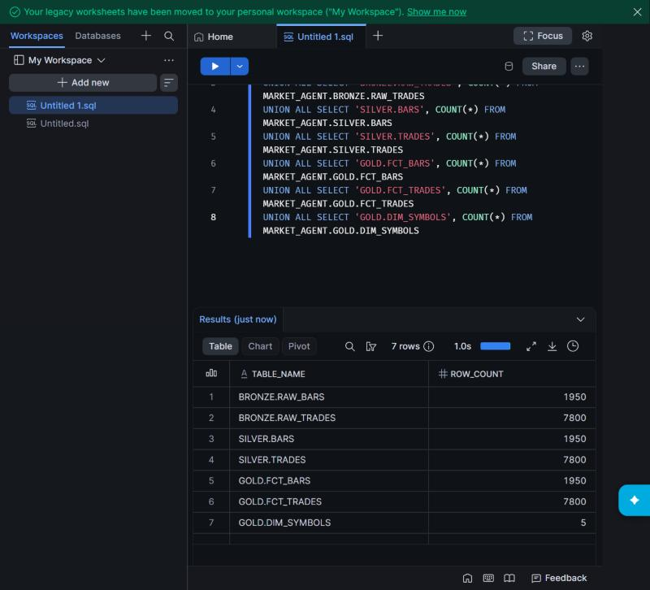
*Every layer reconciles: Bronze → Silver → Gold, 1,950 bars and 7,800 trades.*

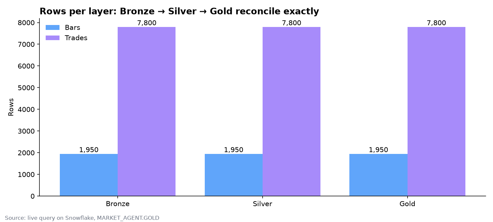

---

## 2. Bugs the live run found (all fixed in this commit)

None of these could be found without running on Snowflake.

| # | Where | What happened | Fix |
|---|---|---|---|
| 1 | `sql/02_bronze`, `sql/04_documents` | `DEFAULT METADATA$FILENAME` is rejected (error 000904): that value exists only inside a `COPY`. All Bronze tables failed to create. The auto-ingest pipes would also have failed: CSVs have fewer columns than the tables. | No default; every load selects `METADATA$FILENAME` in the COPY transformation, including the three pipes in `sql/01_ingest` |
| 2 | `dbt/models/marts/dim_date.sql` | `QUALIFY` without a window function (error 000992) | Plain `WHERE`; day offsets from `ROW_NUMBER()` because `SEQ4()` can have gaps |
| 3 | `sql/07_governance` | `TRANSFORMER`, `BI_READER` and `REALTIME_DESK` had table grants but **no warehouse**, so they couldn't run a single query | Warehouse usage granted |
| 4 | `sql/07_governance` (policy) | **Security:** the delay policy used `IS_ROLE_IN_SESSION('REALTIME_DESK')`, which counts *secondary* roles. Users default to `DEFAULT_SECONDARY_ROLES = ('ALL')`, so a session acting as the agent's role, by a user who also held the real-time role, **saw real-time prices** | Policy checks the primary role: `CURRENT_ROLE() = 'REALTIME_DESK'` — verified across 12 combinations (§5) |
| 5 | `sql/11_monitoring`, `orchestration/checks.py` | `INFORMATION_SCHEMA.TASK_HISTORY` also returns **Snowflake's own system tasks**, so the "task failed" alert would fire on Snowflake's failures | Filtered to `database_name = 'MARKET_AGENT'` |
| 6 | `sql/03_silver`, `sql/04_documents` | Tasks are resumed on creation, so they'd poll every minute from the moment the file runs | Run left them suspended; resume deliberately for live days |

---

## 3. Exploratory data analysis

### Data quality — all checks pass

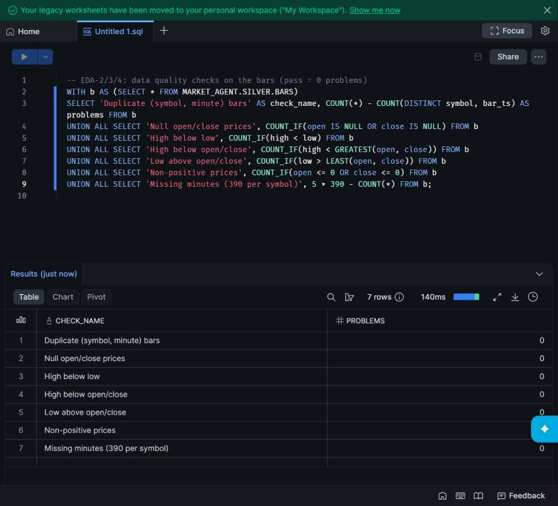

0 duplicate (symbol, minute) bars, 0 null prices, 0 OHLC violations
(high below low, high below open/close, low above open/close), 0 non-positive
prices, and no missing minutes: every stock has exactly 390 one-minute bars
(9:30–16:00 ET), 13:30–19:59 UTC.

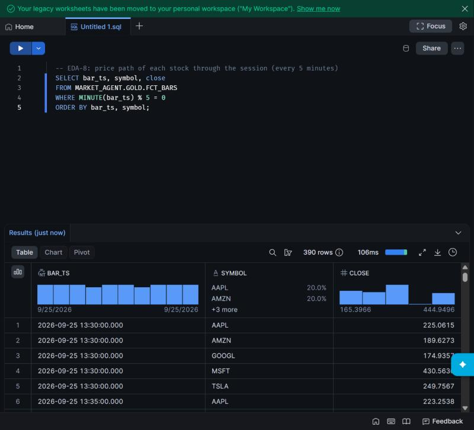
*Snowsight column profiles: even time coverage, each symbol 20% of rows, prices from $165 to $445.*

### What the data says

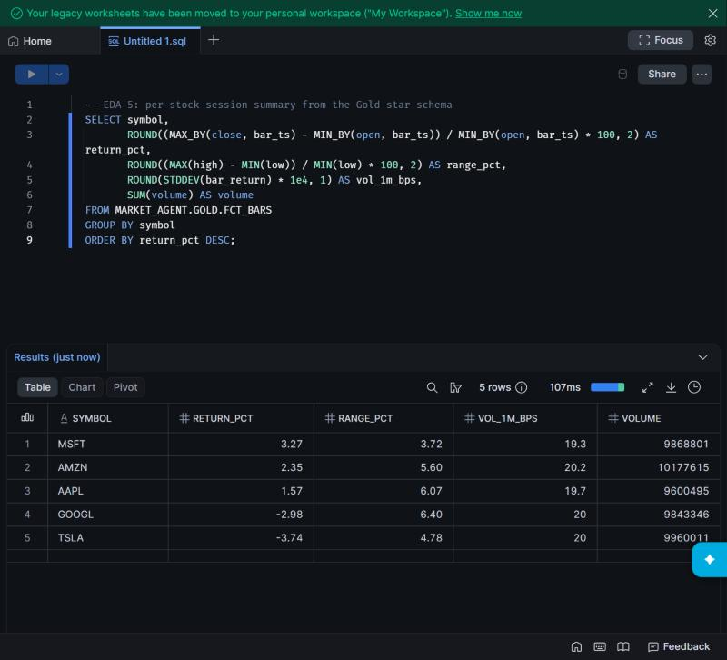

| Stock | Session return | Intraday range | 1-min volatility | Volume |
|---|---|---|---|---|
| MSFT | **+3.27%** | 3.72% | 19.3 bps | 9.87M |
| AMZN | +2.35% | 5.60% | 20.2 bps | 10.18M |
| AAPL | +1.57% | 6.07% | 19.7 bps | 9.60M |
| GOOGL | −2.98% | 6.40% | 20.0 bps | 9.84M |
| TSLA | **−3.74%** | 4.78% | 20.0 bps | 9.96M |

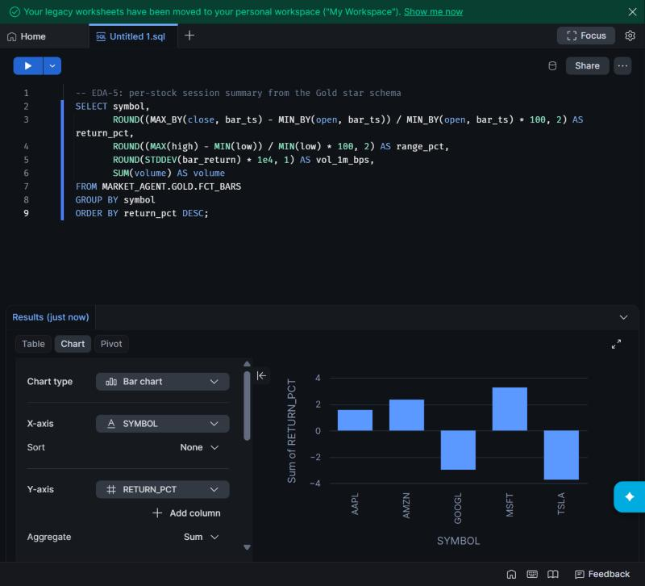

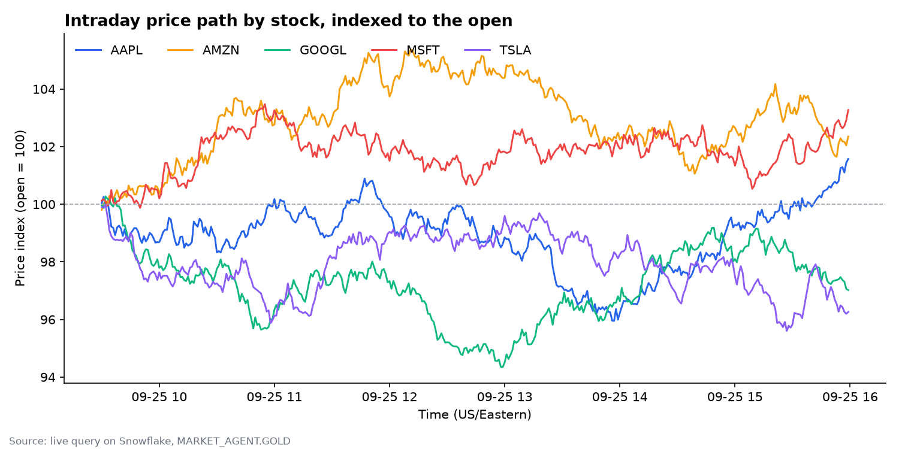
*AMZN led most of the day (up to +5%) before fading; GOOGL fell to −5.6% at midday and partly recovered.*

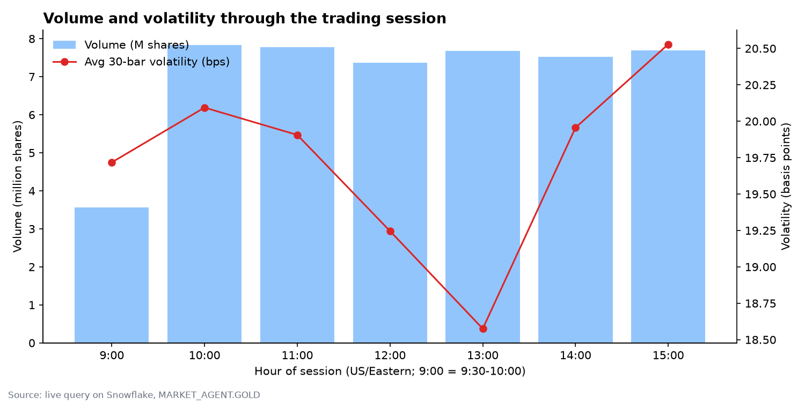
*Volume is steady through the session (the 9:00 bar is half an hour, 9:30–10:00); volatility dips at 13:00 and is highest in the final hour.*

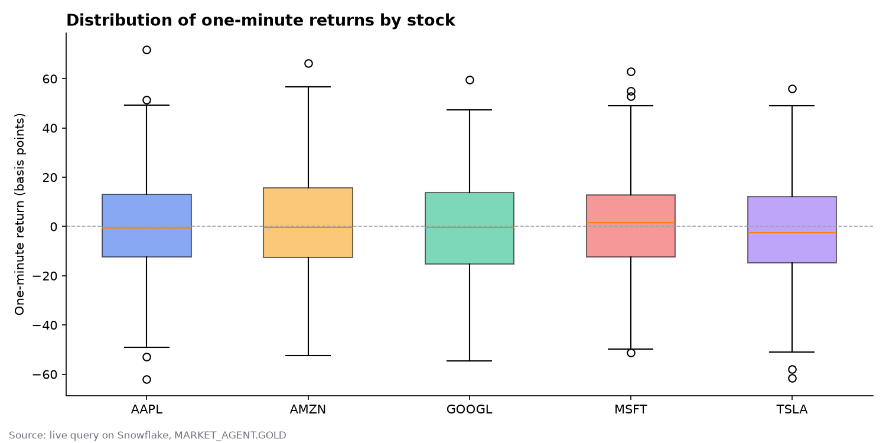
*One-minute returns are tightly centred (5th–95th percentile about ±32 bps) with no bar above the 10% circuit-breaker threshold (`is_suspect` = 0 rows).*

### Finding: trades don't fully reconcile to bars at the closing bell

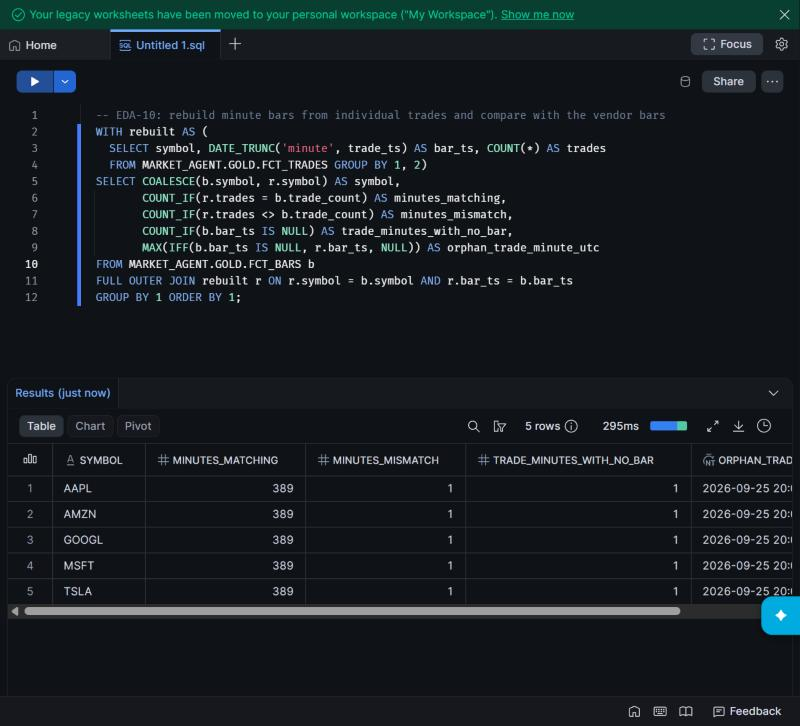

Rebuilding one-minute bars from individual trades matches the vendor's
`trade_count` for **389 of 390 minutes per stock**. In each case the final
trade is stamped exactly 16:00:00 ET (20:00:00 UTC) — the closing bell — so it
falls into a "16:00" minute that has no bar, and the 15:59 bar is one trade
short. This is the boundary problem K4 in `knowledge/problem_catalog.yaml`,
now measured: a real feed needs an explicit rule for trades at the close.

---

## 4. Semantic layer — governed metrics resolve correctly

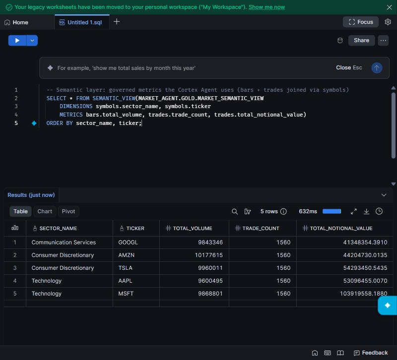

Querying `MARKET_SEMANTIC_VIEW` (the layer Cortex Analyst and the agent use)
combines bar metrics and trade metrics per stock and sector without
double-counting: total volume matches the hand-written query exactly (MSFT
9,868,801), and each stock shows 1,560 trades (7,800 / 5).

---

## 5. Governance — the 15-minute delay, tested

Three demo bars stamped 1, 5 and 40 minutes old were added, Gold rebuilt (the
dbt post-hook re-attached the policy), and the same query run as each role:

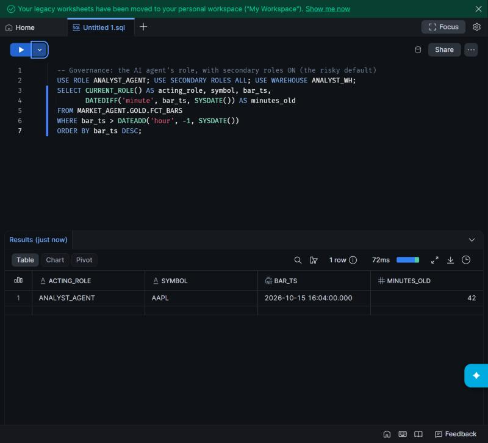
*Acting as ANALYST_AGENT (with secondary roles on): only the 42-minute-old bar is visible.*

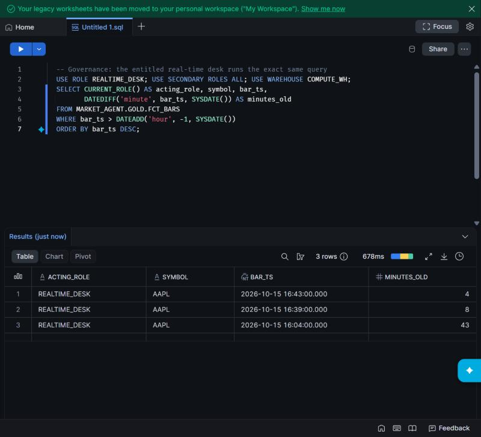
*Acting as REALTIME_DESK: all three bars, including the 4- and 8-minute-old ones.*

**Full matrix — before and after the policy fix** (rows visible out of 3):

| Role | Secondary roles | UTC | Los Angeles | Before fix | After fix |
|---|---|---|---|---|---|
| ANALYST_AGENT | none | 1 | 1 | correct | correct |
| ANALYST_AGENT | all (default) | 3 | 3 | **leaked real-time** | 1 ✓ |
| BI_READER | none | 1 | 1 | correct | correct |
| BI_READER | all (default) | 3 | 3 | **leaked real-time** | 1 ✓ |
| REALTIME_DESK | none / all | 3 | 3 | correct | correct |

Identical results in UTC and Los Angeles sessions confirm the earlier
`SYSDATE()` timezone fix on real Snowflake. The demo rows were removed
afterwards and Gold rebuilt to the original 1,950 bars.

---

## 6. Cortex on a trial account: not available

Creating Cortex Search failed with *"AI function EMBED_TEXT_1024 is not
available for trial accounts"*; the default embedding model, `COMPLETE`,
`AI_COMPLETE` and `SENTIMENT` fail the same way. The Cortex Agent object was
created, but its tools (Cortex Analyst text-to-SQL and Cortex Search) can't
run on this account. The governed layer they depend on — the semantic view,
the row access policy and the agent role — is in place and tested.

Options for the agent part without a paid Snowflake account: the glue agent on
Claude via Vertex AI (`glue/llm.py`, paid through GCP) or a free local model
with Ollama, both querying the same semantic view as `ANALYST_AGENT`.

---

## 7. Reproduce

```bash
# connection: ~/.snowflake/connections.toml, named "market_agent" (key-pair auth)
python streaming/load_sample_to_snowflake.py        # Bronze
cd dbt && dbt build                                  # Gold + tests
python analysis/eda_charts.py                        # charts
```
SQL for every EDA view: `analysis/eda.sql`.
