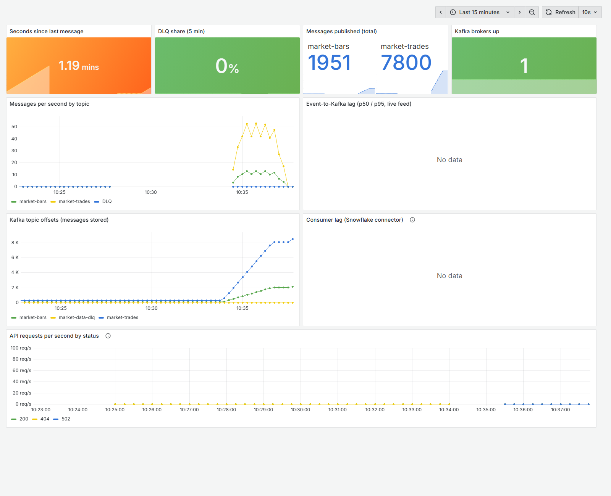
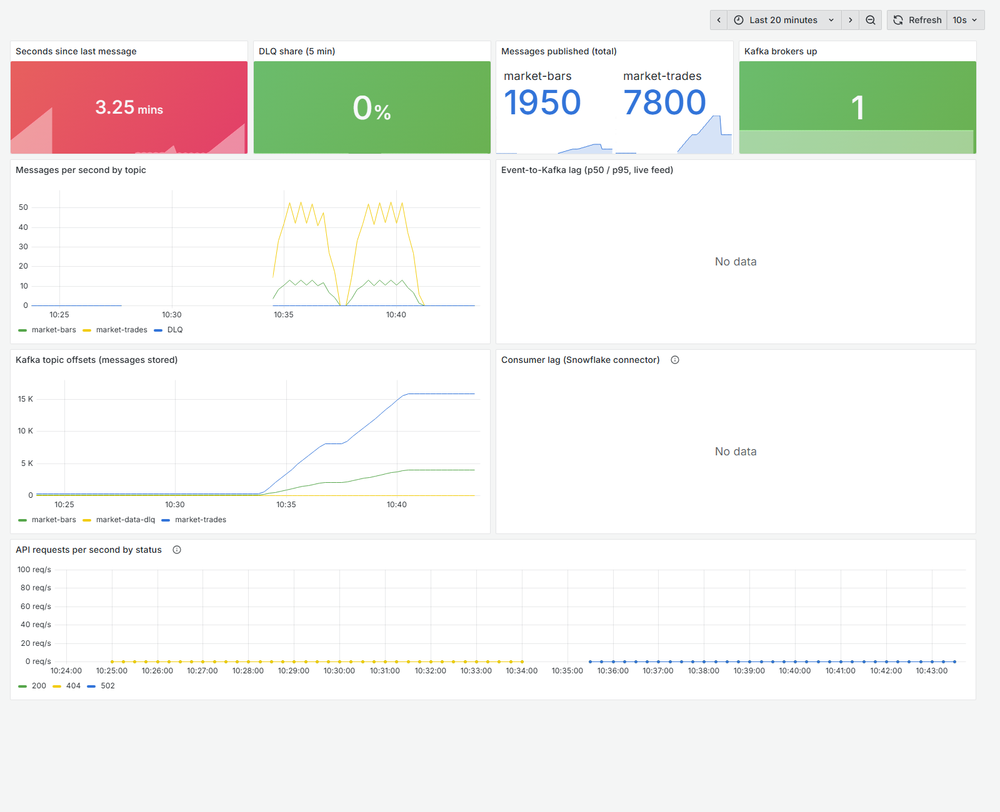
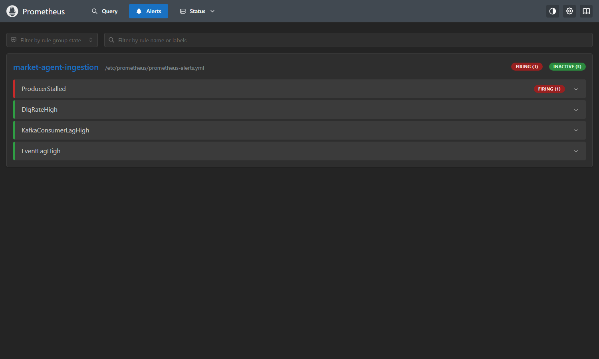
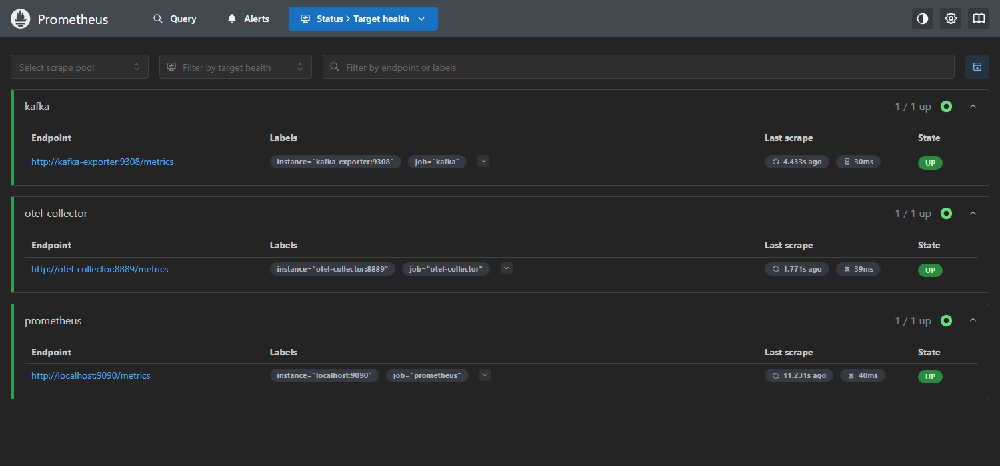
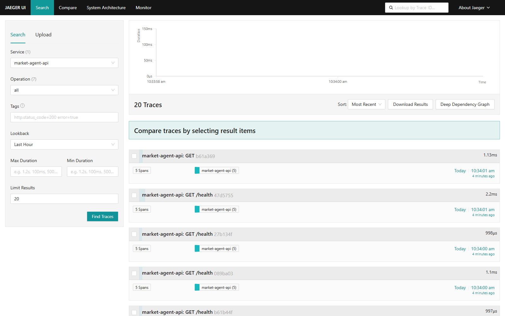

# Stack results: what has actually been run, with evidence

This page records results from real runs, with screenshots. It covers only
what has been executed; anything not shown here is still unverified (see
README "Feature status"). **Snowflake itself has not been run yet** — the
trial account is being connected.

Run date: 14 Oct 2026, on the local stack in `infra/local/docker-compose.yml`
(Kafka 4.1.0, OpenTelemetry Collector 0.135.0, Prometheus 3.6.0, Grafana
12.2.0, Jaeger 2.10.0, kafka-exporter 1.9.0).

---

## 1. A real bug, found by running the stack

**What was run:** a full trading day of sample data (1,950 bars + 7,800
trades) replayed onto local Kafka at 150× speed with telemetry on, plus three
deliberately broken bar rows: a non-numeric price, a high below its low, and
a **missing symbol**.

```bash
cd infra/local && docker compose up -d
OTEL_EXPORTER_OTLP_ENDPOINT=http://localhost:14318 \
  python streaming/replay_sample_data.py --bars-csv <sample_bars + 3 bad rows> --speedup 150
```

**Expected:** 3 rows rejected to the DLQ. **Actual:** only 2. The row with an
empty symbol passed validation — the contract said `symbol: str`, and an
empty string is still a string. That nameless bar reached Kafka (1,951 bars
instead of 1,950) and would have reached Bronze and Silver too: Silver's
`symbol IS NOT NULL` filter doesn't catch `''`.


*Before the fix: Grafana counts 1,951 bars — the real 1,950 plus the nameless one.*

**Fix:** `streaming/schemas.py` now requires a real ticker on every trade,
bar and symbol record (non-empty, upper-case, e.g. `AAPL`, `BRK.B`), and a
non-empty `trade_id`. All 9,755 real sample rows still validate.

**Re-run after the fix:**

| Measure | Before fix | After fix | Source |
|---|---|---|---|
| Bars published | 1,951 | **1,950** | Prometheus (`market_messages_sent_total`) |
| Trades published | 7,800 | **7,800** | Prometheus |
| Rows rejected to DLQ | 2 of 3 | **3 of 3** | Prometheus (`market_dlq_messages_total`) and the replay log |


*After the fix: 1,950 bars and 7,800 trades; message rates for both runs; Kafka offsets; the
"seconds since last message" tile red because the feed has stopped.*

**Independent cross-check — Kafka's own offsets** (cumulative across the day's
three runs) match the app's counts exactly:

| Topic | Runs: test + before fix + after fix | Kafka offset |
|---|---|---|
| market-bars | 100 + 1,951 + 1,950 | **4,001** ✓ |
| market-trades | 300 + 7,800 + 7,800 | **15,900** ✓ |
| market-data-dlq | 1 + 2 + 3 | **6** ✓ |

## 2. The stall alert fires on real silence

`ProducerStalled` (catalog problem A1, a silent feed) fired once no message
had arrived for over 2 minutes during market hours. The other three rules
(DLQ rate, consumer lag, event lag) correctly stayed inactive.



All three scrape targets — Kafka exporter, OTel Collector, Prometheus — are up:



## 3. API instrumentation and traces

The FastAPI service ran with OpenTelemetry on and received 25 `/health`
requests, 3 requests to a route that doesn't exist (404) and 1 `/ask` request.
`/ask` returned **502** because Snowflake isn't connected yet — recorded as a
failed request rather than hidden. Each request produced a trace in Jaeger:



## 4. Other verified results

| Check | Result |
|---|---|
| CI on GitHub (compile, generators, catalog + docs build, dbt parse, Dagster graph, Terraform) | Passing |
| `terraform validate` against real providers (Snowflake 2.21.0, Google 7.46.1) | Valid, no warnings |
| `dagster definitions validate` | Valid; deploy order derived correctly (Bronze → … → Cortex Agent) |
| Sample data generators, DLQ routing, ONNX anomaly model | Verified earlier against sample data |

## 5. Snowflake

The Snowflake side (Bronze → Silver → Gold, governance, dbt) ran on a trial
account afterwards; results and screenshots are in
[snowflake-results.md](snowflake-results.md).

